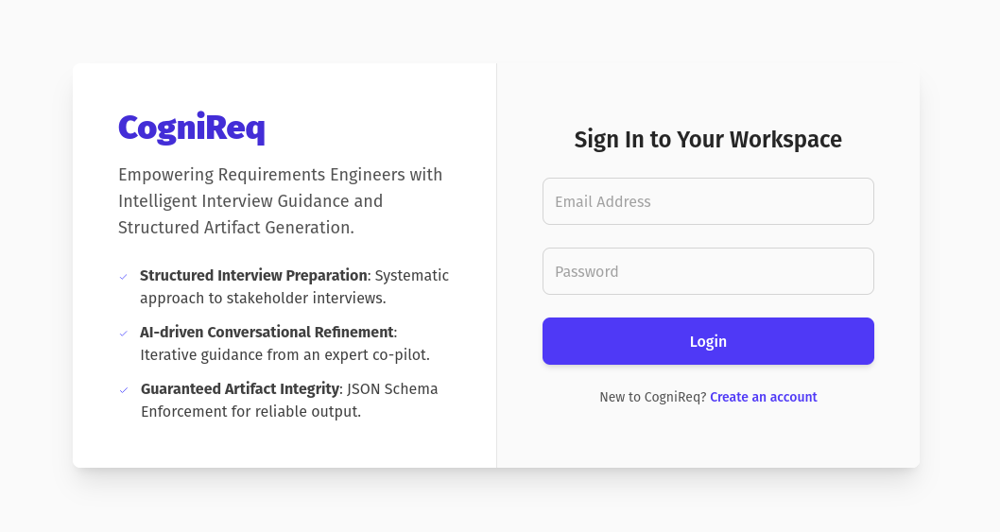
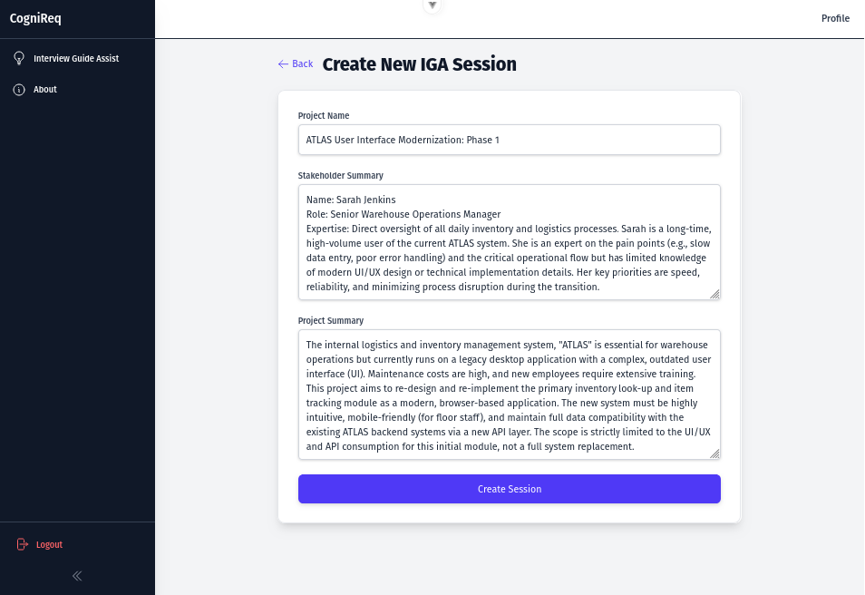
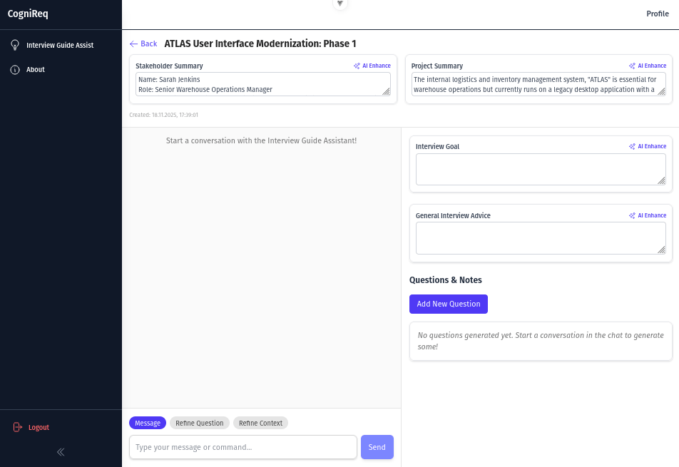

# CogniReq: The First FOSS AI-Native Requirements Management Platform

**Empowering Requirements Engineers with Intelligent Interview Guidance and Structured Artifact Generation.**



## Introduction

CogniReq is a Free and Open Source Software (FOSS) platform dedicated to revolutionizing Requirements Engineering
through AI-native solutions. The mission is to provide innovative tools that enhance clarity, precision, and efficiency
in the requirements gathering process.

Currently, CogniReq's foundational feature is the **Interview Guide Assist (IGA)**, a specialized AI tool designed to
improve the preparation for critical stakeholder interviews. The IGA addresses the common challenge of inconsistent or
incomplete requirements gathering by offering a highly structured and systematic approach, moving beyond traditional,
single-prompt LLM interactions.

## Key Feature: Interview Guide Assist (IGA)

### The Problem

The Interview Guide Assist (IGA) tackles the critical issue of inconsistent and incomplete requirements gathering, often
stemming from a lack of standardized, rigorous guidelines for interview preparation in Requirements Engineering
literature. This gap may lead to crucial information being missed during stakeholder interviews.

### The Solution: IGA's Approach

The IGA provides a highly structured and systematic approach to interview preparation. It moves beyond simple,
single-prompt LLM interactions by requiring the Requirements Engineer (RE) to input initial context (project name,
summaries of the project and stakeholder). This is followed by an **iterative, conversational refinement** process. The
ultimate goal is to produce a well-structured **Interview Guide Artifact** that minimizes the risk of missing crucial
information during the actual interview.



The AI assistant functions as a **structured co-pilot and expert interpreter**. It leverages modern LLM capabilities,
specifically **JSON Schema Enforcement (Structured Output)**, to guarantee the integrity and reliability of the
Interview Guide Artifact.

### User Experience

See for yourself with a small demo GIF:

---



---

In the main user interface, the RE interacts with the AI via a chat pane (1/2 width) to issue refinement commands, such
as "Make Question 5 more open-ended" or "Refine the Project Summary." The AI receives the entire current state of the
structured artifact along with the command and returns a complete, updated version of the guide. This updated content
instantly replaces the previous version in the main display pane (1/2 width). This mechanism ensures **seamless
synchronization** and allows the AI to provide expert-level guidance, not just text generation, while the RE retains
final editorial control.

A unique **Cite Feature** allows the user to click any part of the structured guide, which automatically initiates a
refinement command in the chat. This tightly coupled, dual-pane system enables the RE to efficiently transform raw
project knowledge into a highly systematic and professional interview script, significantly enhancing the rigor of the
requirements elicitation process.

### Key Artifact Components

The AI must generate and maintain the following key features within the Interview Guide Artifact:

* **Interview Goal:** A clear objective for the interview.
* **General Interview Advice:** Best practices and tips for the RE.
* **Questions:** A list of specific, editable questions.
* **Note:** Each question is paired with a corresponding note, providing rationale or follow-up advice for the RE.

## Technology Stack

CogniReq is built with a modern, full-stack approach, leveraging robust and efficient technologies:

* **Backend:** Go
* **Frontend:** Vue.js 3 (Composition API), TypeScript, TailwindCSS v4
* **LLM Integration:** Google Gemini
* **Quality Assurance:**
    * ✅ **>70% Test Coverage**, including mocked AI behavior for various interactions (create, update, delete
      questions, refine context data).
    * ✅ **Automatic Testing** using GitHub Actions ensures continuous integration and code quality.

## Architecture Overview

The application employs a strong separation of concerns, following a layered architecture to ensure maintainability,
scalability, and clarity:

* **Web Handler:** Manages request/response DTOs.
* **Service Layer:** Contains the core business logic and domain models.
* **Database Layer:** Handles data persistence, utilizing SQLC for efficient and type-safe database interactions.

## Getting Started (How to Run)

To get CogniReq up and running quickly, it's recommended to use Docker and Docker Compose.

### Prerequisites

* **Docker:** Ensure Docker is installed and running on your system. You can download it
  from [Docker's official website](https://www.docker.com/get-started).
* **Docker Compose:** This is usually included with Docker Desktop
  installations, [see Docker's official website for more info](https://docs.docker.com/compose/).

### Steps

1. **Clone the Repository:**
   ```bash
   git clone git@github.com:jensilo/cognireq.git
   cd cognireq
   ```

2. **Configure Environment Variables:**
   Navigate to the `docker/dev` directory and copy the example environment file:
   ```bash
   cd docker/dev
   cp .env.dist .env
   ```
   Edit the `.env` file and fill in your Google Gemini API key:
   ```
   # .env
   GEMINI_API_KEY = YOUR_GEMINI_API_KEY_HERE
   ```
   *(You can obtain a Google Gemini API key from [Google AI Studio](https://aistudio.google.com/app/apikey).)*

3. **Build and Run with Docker Compose:**
   From the `docker/dev` directory, run:
   ```bash
   docker compose up
   ```
   This command will:
    * Build the Docker images for the backend and database.
    * Start the database, backend, and frontend services.
    * The application will be accessible at `http://localhost:5173` (frontend) and the API at `http://localhost:8080` (
      backend).

4. **Access the Application:**
   Open your web browser and navigate to `http://localhost:5173`.

5. **Stop the Application:**
   To stop the running services, press `Ctrl+C` in the terminal where `docker compose` is running, or execute:
   ```bash
   docker compose down
   ```

## Roadmap and Future Vision

CogniReq is envisioned as a comprehensive AI-native Requirements Management platform. While the Interview Guide Assist (
IGA) is its initial core offering, our roadmap includes expanding its capabilities to cover the full requirements
lifecycle. Future features may include:

* **Convenient Requirements Generation:** Conveniently generate high-quality requirements directly and seamlessly from
  requirements elicitation interview results.
* **Advanced Requirements Analysis:** AI-driven insights into requirements quality, consistency, and completeness.
* **Automated Traceability:** Tools for establishing and maintaining traceability between requirements, design, and
  tests.
* **Integration with RE Tools:** Seamless integration with popular requirements management and project planning tools.
* **Collaborative Features:** Enhancing teamwork in requirements elicitation and management.

The goal is to continuously evolve CogniReq, making it the go-to FOSS solution for intelligent requirements engineering.
(maybe one day... ;))

## Contributing

Contributions are welcome from anybody! Just submit a PR, or reach out to me.

## Disclaimer

CogniReq is currently under active development and is considered a prototype. Production-grade stability or security is
not guranteed. Users should exercise caution and not rely on it for mission-critical applications without thorough
independent validation.

## License

This project is licensed under the [MIT License](LICENSE).

